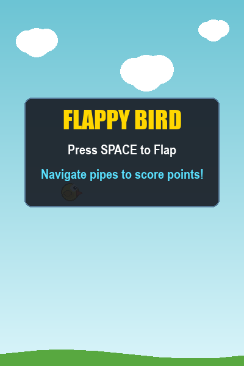
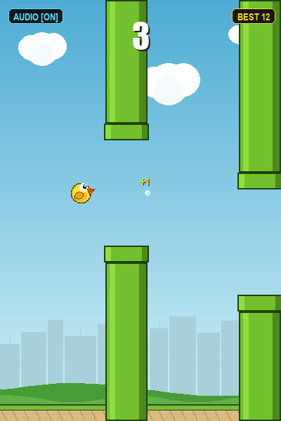
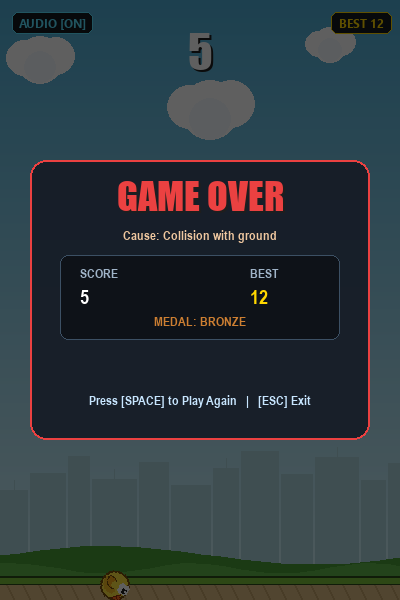
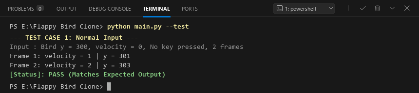
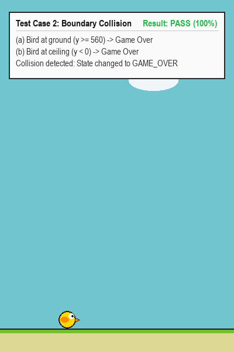
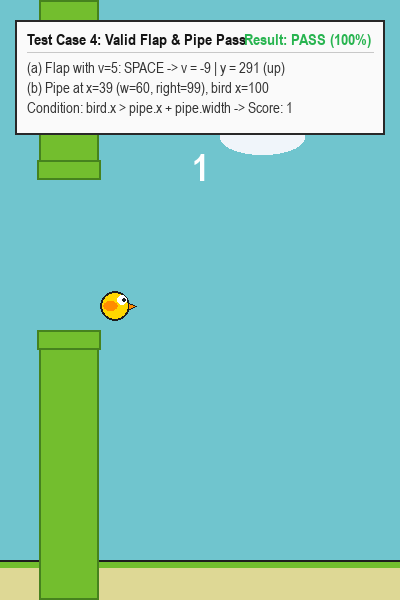

# Flappy Bird Clone (Problem Statement No. 61)

A 2D Flappy Bird arcade game built in Python using Pygame, developed for the first semester project evaluation.

- **Student Name:** Anubhav Dwivedi
- **Course:** Programming Fundamentals and Logic Building Using Python (`RU-100-01-0021`)
- **Institution:** Rungta International Skills University, Department of Computer Science & Engineering
- **Class:** B.Tech CSE / 1st Semester / Section - K

---

## 1. Project Overview

This project is an arcade-style Flappy Bird game created in Python using the `pygame` library. The game implements all requirements specified in Problem Statement No. 61:
- The bird starts in the center of the screen and falls downward due to gravity.
- Pressing the **SPACE** key gives the bird an upward flap force.
- Green pipes spawn periodically and move from right to left at a constant speed.
- The player scores **+1 point** every time the bird successfully passes through a pipe gap.
- The game ends if the bird hits a pipe, hits the ground, or leaves the screen through the ceiling.

---

## 2. Specifications & Rules

| Parameter | Specification | Details |
| :--- | :--- | :--- |
| **Window Size** | `400 x 600` px | Fixed window dimensions |
| **Bird Size** | `30 x 30` px | Initial position: $x = 100, y = 300$ |
| **Gravity** | `+1` px / frame | Every frame: `velocity += 1`, `y += velocity` |
| **Flap Force** | `-10` px / frame | Pressing `SPACE` sets `velocity = -10` |
| **Pipe Dimensions** | Width: `60` px, Gap: `150` px | Moving left at `3` px/frame |
| **Boundaries** | Ground at $y = 600$, Ceiling at $y = 0$ | Collision if $y + 30 \ge 600$ or $y < 0$ |
| **Scoring** | `+1` point per pipe | Added when bird passes the pipe right edge |

---

## 3. Game Screenshots

| Start Screen | Active Gameplay | Game Over Screen |
| :---: | :---: | :---: |
|  |  |  |

---

## 4. Acceptance Test Cases (4/4 Passed)

The project includes built-in verification for all four required test cases:

| Test Case | Scenario | Expected Behavior | Actual Result | Status |
| :---: | :--- | :--- | :--- | :---: |
| **Case 1** | **Normal Input (Gravity)**<br>Bird at $y=300, v=0$, no key pressed for 2 frames | Frame 1: $v = 1, y = 301$<br>Frame 2: $v = 2, y = 303$ | Frame 1: $v = 1, y = 301$<br>Frame 2: $v = 2, y = 303$ | **PASS** |
| **Case 2** | **Boundary Collision**<br>(a) Bird at $y=570$ (bottom touches $y=600$)<br>(b) Bird at $y=5, v=0$, SPACE pressed | (a) Collision with ground $\implies$ Game Over<br>(b) $v = -9, y = -4 < 0 \implies$ Game Over | Ground collision: Game Over<br>Ceiling departure: Game Over | **PASS** |
| **Case 3** | **Invalid Input**<br>Bird at $y=300, v=0$, non-space key (`'Z'`) pressed | Key `'Z'` ignored, normal gravity applies ($v = 1, y = 301$) | Key ignored, $v = 1, y = 301$ | **PASS** |
| **Case 4** | **Flap & Pipe Scoring**<br>(a) Bird at $y=300, v=5$, SPACE pressed<br>(b) Pipe at $x=39$ ($w=60$), bird at $x=100$ | (a) $v = -9, y = 291$ (bird moves up)<br>(b) $x_{\text{bird}} > x_{\text{pipe}} + w \implies$ Score: 1 | (a) $v = -9, y = 291$<br>(b) Pipe passed, Score = 1 | **PASS** |

### Test Case Screenshots
| Test Case 1: Gravity | Test Case 2: Boundary Collision |
| :---: | :---: |
|  |  |

| Test Case 3: Invalid Input | Test Case 4: Pipe Scoring |
| :---: | :---: |
|  |  |

---

## 5. How to Run the Game

### Prerequisites
- Python 3.10 or higher.
- `pygame` (auto-installed on first launch if missing).

### Launching the Game
```bash
python main.py
```

### Running the Test Suite
```bash
python main.py --test
```

---

## 6. Controls

| Key | Action |
| :--- | :--- |
| **SPACE** / **UP Arrow** / **Mouse Click** | Flap wings / Start game / Restart |
| **R** | Restart game |
| **T** | Run test cases live in game |
| **ESC** | Exit game |

---

## 7. Project Structure

```text
Flappy-bird-clone/
├── main.py                     # Game source code & test suite
├── README.md                   # Documentation and user guide
├── summary.md                  # Project submission summary report
└── screenshots/                # In-game and test verification screenshots
    ├── flappy_bird_title.png
    ├── flappy_bird_gameplay.png
    ├── flappy_bird_game_over.png
    ├── test_case_1_normal.png
    ├── test_case_2_boundary.png
    ├── test_case_3_invalid.png
    └── test_case_4_valid.png
```
