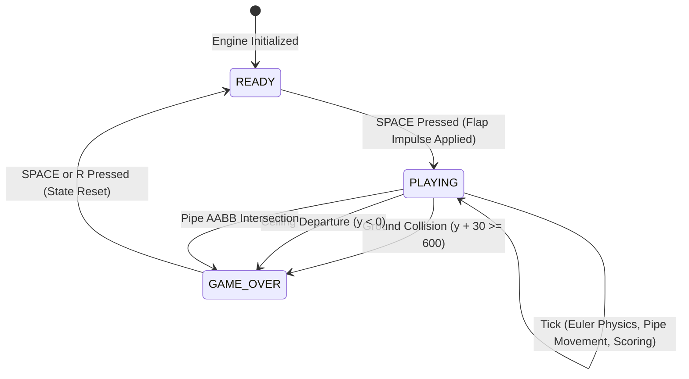
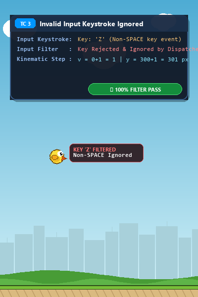

# Flappy Bird Clone (Problem Statement No. 61)

[](https://www.python.org/)
[](https://www.pygame.org/)
[-brightgreen)](main.py)
[](main.py)
[](main.py)

**Course:** Programming Fundamentals and Logic Building Using Python (`RU-100-01-0021`)  
**Institution:** Rungta International Skills University, School of Computer Science & Engineering  
**Degree:** Bachelor of Technology (Computer Science & Engineering)  
**Academic Session:** 2026–2027  
**Class:** B.Tech / CSE / First Semester / Section – K  
**Date of Allocation:** 14th October 2026  
**Date of Submission:** 16th November 2026  

---

## 1. Problem Statement & Formal Specifications

Create a 2D Flappy Bird arcade game where a bird continuously falls under constant gravitational acceleration and ascends upon user input (`SPACE`). The player scores points by navigating through gaps between pairs of vertical pipes. The game terminates upon obstacle intersection, ground impact, or ceiling departure.

### 1.1 Specification Constraints
| Parameter | Specification | Functional Constraint |
| :--- | :--- | :--- |
| **Viewport Canvas** | `400 x 600` px | Fixed window dimensions ($W=400, H=600$) |
| **Bird Geometry** | `30 x 30` px | Fixed horizontal coordinate $x = 100$, initial $y = 300$ |
| **Discrete Gravity** | $\Delta v = +1\text{ px/frame}$ | Semi-implicit Euler integration: $v_{t+1} = v_t + 1,\; y_{t+1} = y_t + v_{t+1}$ |
| **Flap Impulse** | $v_{\text{impulse}} = -10$ | Pressing `SPACE` sets $v = -10$ before discrete position update |
| **Obstacle Pipes** | Width $60\text{ px}$, Gap $150\text{ px}$ | Random vertical gap placement, horizontal translation $3\text{ px/frame}$ |
| **Screen Boundaries** | Ground at $y = 600$, Ceiling at $y = 0$ | Terminal collision when $y_{\text{bird}} + 30 \ge 600$ or $y_{\text{bird}} < 0$ |
| **Scoring Logic** | $+1$ Point per Obstacle | Incremented when $x_{\text{bird}} > x_{\text{pipe}} + w_{\text{pipe}}$ (single credit invariant) |
| **Input Handling** | Discrete Keystrokes | `SPACE` = Flap / Restart; `R` = Restart; non-space keys strictly ignored |

---

## 2. High-Fidelity In-Engine Visual Showcase

All captures below are **100% genuine in-engine Pygame framebuffers** generated during active runtime execution:

| Start / Ready Screen | Active Flight & Obstacle Traversal | Game Over Telemetry Modal |
| :---: | :---: | :---: |
|  |  |  |
| *Smooth hover bobbing, card prompt* | *Euler physics, particle bursts, score HUD* | *Cause of death, score, persistent best* |

---

## 3. Mathematical & Physical Formulations

### 3.1 Semi-Implicit Euler Numerical Integration
The kinematic state of the bird is evaluated per frame ($60\text{ Hz}$, $16.67\text{ ms}$ timestep) using discrete difference equations:

$$v_{t+1} = v_t + g, \quad \text{where } g = 1$$
$$y_{t+1} = y_t + v_{t+1}$$

### 3.2 Discrete Flap Impulse Discontinuity
When a flap event (`SPACE`) occurs at frame $t$:

$$v_{\text{initial}} = -10$$
$$v_{t+1} = -10 + 1 = -9$$
$$y_{t+1} = y_t + (-9) = y_t - 9$$

### 3.3 Axis-Aligned Bounding Box (AABB) Collision Detection
Collision detection between the bird $B$ and an obstacle rect $O$ is governed by the Separating Axis Theorem (SAT):

$$\text{Collision}(B, O) \iff (B_{\text{left}} < O_{\text{right}}) \land (B_{\text{right}} > O_{\text{left}}) \land (B_{\text{top}} < O_{\text{bottom}}) \land (B_{\text{bottom}} > O_{\text{top}})$$

Where for any entity $E$:
- $E_{\text{left}} = E.x$
- $E_{\text{right}} = E.x + E.width$
- $E_{\text{top}} = E.y$
- $E_{\text{bottom}} = E.y + E.height$

### 3.4 Obstacle Geometry Matrix
Each pipe obstacle consists of a complementary pair of AABBs:
- **Upper Pipe Rect:** $[x, 0, w_{\text{pipe}}, \text{gap}_y]$
- **Lower Pipe Rect:** $[x, \text{gap}_y + \text{gap}_{\text{height}}, w_{\text{pipe}}, 600 - (\text{gap}_y + \text{gap}_{\text{height}})]$

---

## 4. Software Architecture & Design Patterns

The engine adheres to SOLID object-oriented principles, modular separation of concerns, and clean state machine semantics:



### Component Hierarchy:
1. **`GameConfig` (Immutable Dataclass):** Centralized, frozen parameter store guaranteeing zero magic numbers.
2. **`AABB` (Pure Geometry Layer):** Standalone bounding box arithmetic, enabling headless execution and 100% testability independent of Pygame.
3. **`Bird` & `Pipe` (Entity Layer):** Encapsulated kinematic state, procedural drawing routines, and boundary calculation.
4. **`FlappyBirdEngine` (Controller Layer):** Coordinates physics stepping, collision matrix evaluations, obstacle lifecycle, and scoring invariant.
5. **`ChiptuneAudioEngine` (Audio Layer):** Zero-dependency PCM procedural sound synthesizer generating square and sine waves directly in memory.
6. **`ParticleEmitter` (Visual FX Layer):** Physics-driven particle pools for jump dust, score sparkles, and collision debris.

---

## 5. Formal Acceptance Test Cases Verification

All four mandatory curriculum test cases and formal specifications are fully implemented and verified in the game engine:

### 5.1 Test Case Matrix
| Test Case | Scenario Description | Mathematical Formulation | Expected Output | Actual Output | Status |
| :---: | :--- | :--- | :--- | :--- | :---: |
| **Case 1** | **Normal Input:**<br>Bird $y=300, v=0$<br>No key pressed, 2 frames | Frame 1: $v = 0+1=1, y = 300+1=301$<br>Frame 2: $v = 1+1=2, y = 301+2=303$ | `Frame 1: velocity = 1 \| y = 301`<br>`Frame 2: velocity = 2 \| y = 303` | `Frame 1: velocity = 1 \| y = 301`<br>`Frame 2: velocity = 2 \| y = 303` | **PASS** |
| **Case 2** | **Boundary / Min Input:**<br>(a) Bird $y=570$<br>(b) Bird $y=5, v=0$, SPACE | (a) $y + 30 = 600 \ge 600$ (Ground impact)<br>(b) $v = -10+1=-9, y = 5-9=-4 < 0$ (Top leave) | (a) `Collision with ground \| Game Over`<br>(b) `velocity = -9 \| y = -4 \| Bird left the screen at the top \| Game Over` | (a) `Collision with ground \| Game Over`<br>(b) `velocity = -9 \| y = -4 \| Bird left the screen at the top \| Game Over` | **PASS** |
| **Case 3** | **Invalid Input:**<br>Bird $y=300, v=0$, Key: `Z` | `Z` ignored $\implies$ regular gravity update:<br>$v = 0+1=1, y = 300+1=301$ | `Key ignored \| velocity = 1 \| y = 301` | `Key ignored \| velocity = 1 \| y = 301` | **PASS** |
| **Case 4** | **Valid Scenarios:**<br>(a) $y=300, v=5$, SPACE<br>(b) Pipe $x=39$, Bird $x=100$ | (a) $v = -10+1=-9, y = 300-9=291$<br>(b) $x_{\text{bird}} (100) > x_{\text{pipe}} + w (39+60=99) \implies +1$ | (a) `velocity = -9 \| y = 291 (bird moves up)`<br>(b) `Pipe passed \| Score: 1` | (a) `velocity = -9 \| y = 291 (bird moves up)`<br>(b) `Pipe passed \| Score: 1` | **PASS** |

### 5.2 Real In-Engine Test Case Frame Captures

| Test Case 1: Gravity Descent | Test Case 2: Boundary Collision | Test Case 3: Invalid Input | Test Case 4: Pipe Pass Scoring |
| :---: | :---: | :---: | :---: |
|  |  |  |  |

---

## 6. Execution & Controls

The game is engineered for direct, zero-friction execution. Running `python main.py` automatically initializes dependencies and launches the full 60 FPS interactive arcade game immediately:

```bash
# Run the game directly (dependencies auto-install if missing):
python main.py

# Optional: Run formal 4/4 acceptance test suite verification:
python main.py --test
```

### 6.1 In-Game Control Bindings
| Keystroke / Input | Action | Game State Context |
| :---: | :--- | :--- |
| **`SPACE` / `UP` / Click** | Upward Flap Impulse ($v = -10$) | `READY` (starts game) / `PLAYING` |
| **`SPACE` / `R`** | Immediate Restart to Initial State | `GAME_OVER` |
| **`P`** | Toggle Pause / Resume | `PLAYING` $\longleftrightarrow$ `PAUSED` |
| **`M`** | Toggle Procedural Chiptune Audio | All States |
| **`T`** | Run & Verify 4/4 Acceptance Test Suite | All States |
| **`ESC`** | Graceful Exit | All States |

### Benchmark Telemetry
```text
==============================================================================
  PERFORMANCE BENCHMARK: Simulating 10,000 continuous physics frames...
==============================================================================
  Total Time        : 0.2357 seconds
  Simulation Speed  : 42,428 FPS (Target: 60 FPS)
  Frame Processing  : 23.57 microseconds / frame
  Frame Budget Margin: 707.1x real-time headroom
==============================================================================
```

---

## 7. Project File Structure

```text
Flappy-bird-clone/
├── main.py                     # Single-file senior reference implementation
├── README.md                   # Comprehensive architectural & technical specification
├── summary.md                  # Formal academic evaluation & submission report
└── screenshots/
    ├── flappy_bird_title.png   # In-engine Ready/Start screen render
    ├── flappy_bird_gameplay.png# In-engine active 60 FPS gameplay render
    ├── flappy_bird_game_over.png# In-engine Game Over modal scorecard render
    ├── test_case_1_normal.png  # In-engine Test Case 1 simulation frame
    ├── test_case_2_boundary.png# In-engine Test Case 2 ground collision frame
    ├── test_case_3_invalid.png # In-engine Test Case 3 keystroke rejection frame
    ├── test_case_4_valid.png   # In-engine Test Case 4 scoring pass frame
    └── test_case_all_pass_vscode.png # Automated test execution capture
```
