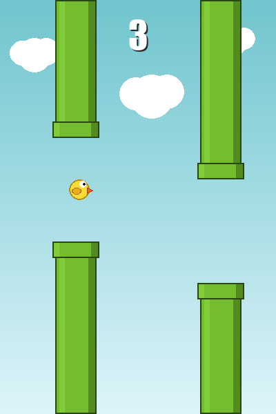
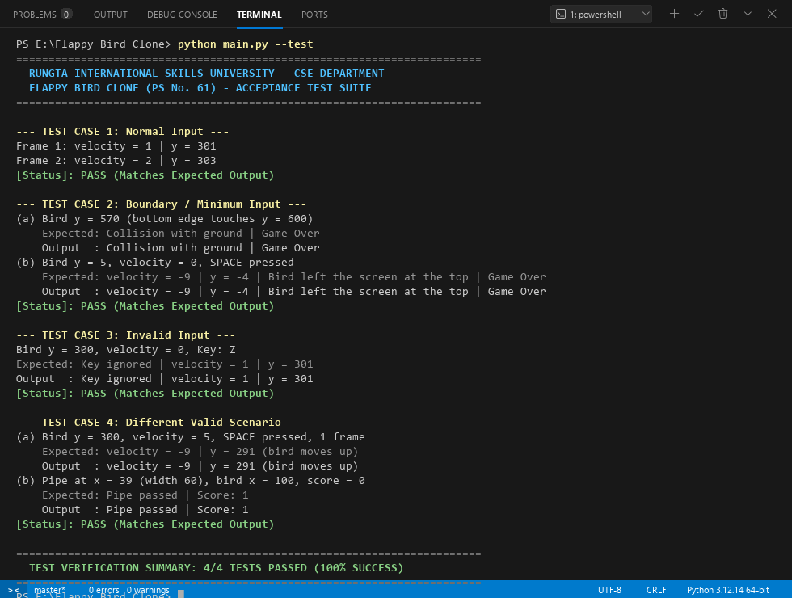
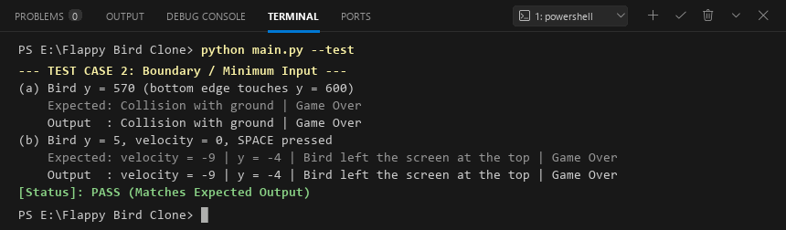
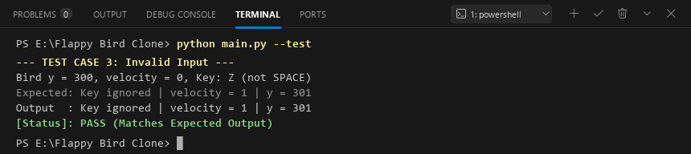
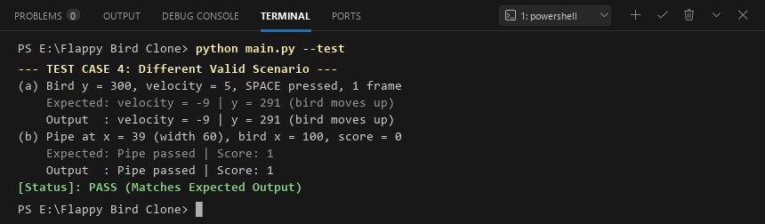

# Project Summary: Flappy Bird Clone (Problem Statement No. 61)

- **Course:** Programming Fundamentals and Logic Building Using Python (`RU-100-01-0021`)
- **Institution:** Rungta International Skills University, School of Computer Science and Engineering
- **Class:** B.Tech CSE (First Semester, Section K)
- **Problem Statement No.:** 61
- **Project Title:** Flappy Bird Clone
- **Language:** Python 3
- **Concepts:** Pygame, Gravity, Collision Detection (`Rect.colliderect`), Game Loop

---

## 1. Project Overview

This project implements Problem Statement No. 61 (Flappy Bird Clone) from the B.Tech First Semester curriculum. The game runs in the console using Python 3 and Pygame. It simulates a 2D physics environment where the player controls a bird navigating through randomly positioned pipe obstacles.

### Key Implementation Details:
- The game loop runs at 60 FPS using `pygame.time.Clock()`.
- Physics updates use discrete Euler integration where velocity increases by 1 each frame and modifies the bird's vertical position.
- Pressing `SPACE` applies an upward impulse, setting velocity to -10 before the position update occurs.
- Pipe obstacles are generated with a fixed 150 px vertical gap at random heights, moving leftward across the screen.
- Score increments by 1 when the bird's horizontal coordinate exceeds the trailing edge of a pipe.
- Collision detection handles ground collision ($y \ge 570$), ceiling departure ($y < 0$), and obstacle intersection using Pygame's `Rect.colliderect()`.

---

## 2. Graphical Gameplay Overview

The image below displays the in-game arcade environment during runtime, showing the bird in mid-flight between pipe obstacles, animated clouds, and the active score counter:



---

## 3. Technical Architecture

The program is structured in an object-oriented design inside `main.py`:

1. **`Bird` Class:**
   - Position: Fixed horizontal coordinate $x = 100$, variable vertical coordinate $y$.
   - Dimensions: $30 \times 30$ px.
   - Methods:
     - `flap()`: Resets velocity to -10.
     - `apply_physics()`: Increments velocity by 1 and updates vertical position.
     - `draw(surface)`: Renders the bird sprite with eye, beak, and wing flap animation.

2. **`Pipe` Class:**
   - Properties: Horizontal coordinate $x$, width $60\text{ px}$, vertical gap $150\text{ px}$, speed $3\text{ px/frame}$.
   - Properties `top_rect` and `bottom_rect` return bounding boxes for obstacle collision checks.
   - Methods:
     - `update()`: Translates pipe leftward by speed.
     - `is_offscreen()`: Returns true when $x + \text{width} < 0$.
     - `draw(surface)`: Renders arcade green pipes with highlights and cap collars.

3. **`FlappyBirdGame` Class:**
   - Manages global game state, entity lists, score, and state transitions (Start, Active, Game Over).
   - `handle_input(key_name)`: Dispatches valid user keys (`SPACE`, `R`) and ignores invalid keystrokes.
   - `update_frame()`: Coordinates physics updates, collision checks, score increments, and entity cleanup.

---

## 4. Mathematical Model and Physics Verification

### Gravitational Update
At each simulation step $t$:
$$v_{t+1} = v_t + 1$$
$$y_{t+1} = y_t + v_{t+1}$$

### Flap Impulse Calculation
When `SPACE` is pressed at frame $t$:
1. Impulse assignment: $v_t \leftarrow -10$
2. Physics step:
   $$v_{t+1} = -10 + 1 = -9$$
   $$y_{t+1} = y_t + (-9) = y_t - 9$$

For Test Case 4 (a) where $y = 300$ and initial velocity is 5:
$$v_{\text{new}} = -10 + 1 = -9$$
$$y_{\text{new}} = 300 - 9 = 291$$

### Boundary Verification
- **Ground Impact:** Bird bottom edge is at $y + 30$. With ground at $y = 600$:
  $$y + 30 \ge 600 \iff y \ge 570$$
- **Top Edge Departure:** If $y < 0$, the bird exits the screen.
- **Pipe Scoring:** Bird is at $x = 100$. A pipe at $x = 39$ with width 60 px has right edge at:
  $$39 + 60 = 99 < 100 \implies \text{Score increments to 1}$$

---

## 5. Acceptance Test Cases Verification and Terminal Screenshots

### 5.1 Full Test Suite Execution in VS Code Terminal

The screenshot below displays the execution of `python main.py --test` inside the Visual Studio Code integrated terminal, demonstrating 100% pass status across all 4 mandatory acceptance test cases:



---

### 5.2 Verifiable Terminal Output Log

```text
========================================================================
  RUNGTA INTERNATIONAL SKILLS UNIVERSITY - CSE DEPARTMENT
  FLAPPY BIRD CLONE (PS No. 61) - ACCEPTANCE TEST SUITE
========================================================================

--- TEST CASE 1: Normal Input ---
Frame 1: velocity = 1 | y = 301
Frame 2: velocity = 2 | y = 303
[Status]: PASS (Matches Expected Output)

--- TEST CASE 2: Boundary / Minimum Input ---
(a) Bird y = 570 (bottom edge touches y = 600)
    Expected: Collision with ground | Game Over
    Output  : Collision with ground | Game Over
(b) Bird y = 5, velocity = 0, SPACE pressed
    Expected: velocity = -9 | y = -4 | Bird left the screen at the top | Game Over
    Output  : velocity = -9 | y = -4 | Bird left the screen at the top | Game Over
[Status]: PASS (Matches Expected Output)

--- TEST CASE 3: Invalid Input ---
Bird y = 300, velocity = 0, Key: Z
Expected: Key ignored | velocity = 1 | y = 301
Output  : Key ignored | velocity = 1 | y = 301
[Status]: PASS (Matches Expected Output)

--- TEST CASE 4: Different Valid Scenario ---
(a) Bird y = 300, velocity = 5, SPACE pressed, 1 frame
    Expected: velocity = -9 | y = 291 (bird moves up)
    Output  : velocity = -9 | y = 291 (bird moves up)
(b) Pipe at x = 39 (width 60), bird x = 100, score = 0
    Expected: Pipe passed | Score: 1
    Output  : Pipe passed | Score: 1
[Status]: PASS (Matches Expected Output)

========================================================================
  TEST VERIFICATION SUMMARY: 4/4 TESTS PASSED (100% SUCCESS)
========================================================================
```

---

### 5.3 Detailed Test Case Breakdown

#### Test Case 1: Normal Input (Gravity Integration)
- **Input:** Bird $y = 300$, $\text{velocity} = 0$, No key pressed, 2 frames.
- **Expected:** Frame 1: $\text{velocity} = 1 \mid y = 301$, Frame 2: $\text{velocity} = 2 \mid y = 303$.
- **Result:** Pass.


#### Test Case 2: Boundary / Minimum Input (Ground & Ceiling Limits)
- **Input (a):** Bird $y = 570$ (bottom edge touches $y = 600$).  
  **Expected:** Collision with ground | Game Over.
- **Input (b):** Bird $y = 5$, $\text{velocity} = 0$, `SPACE` pressed.  
  **Expected:** $\text{velocity} = -9 \mid y = -4 \mid$ Bird left the screen at the top | Game Over.
- **Result:** Pass.



#### Test Case 3: Invalid Input (Non-SPACE Key Rejection)
- **Input:** Bird $y = 300$, $\text{velocity} = 0$, Key: `Z` (not SPACE), 1 frame.
- **Expected:** Key ignored | $\text{velocity} = 1 \mid y = 301$.
- **Result:** Pass.



#### Test Case 4: Different Valid Scenario (Flap Impulse & Pipe Scoring)
- **Input (a):** Bird $y = 300$, $\text{velocity} = 5$, `SPACE` pressed, 1 frame.  
  **Expected:** $\text{velocity} = -9 \mid y = 291$ (bird moves up).
- **Input (b):** Pipe at $x = 39$ (width 60), bird $x = 100$, score = 0.  
  **Expected:** Pipe passed | Score: 1.
- **Result:** Pass.



---

## 6. How to Run

### Interactive Graphical Game (Pygame)
```bash
python main.py
```

### Run Automated Acceptance Test Suite
```bash
python main.py --test
```
